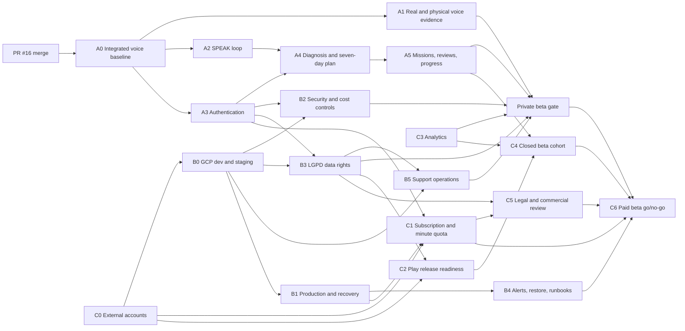

# Paid Android beta critical path

## Delivery strategy

The shortest safe path has three parallel tracks that converge twice: first at
an instrumented private beta, then at a paid closed beta. Milestones are based
on objective evidence rather than target dates.

The first hard dependency is the human squash merge of
[PR #16](https://github.com/arturconrado/english-sprint-ai/pull/16). Product
implementation must not stack on the draft Phase 1 branch.

## Milestones

### Integrated Voice Baseline

Entry:

- PR #16 remains unchanged and has green checks.

Exit:

- PR #16 is squash-merged by the owner.
- Updated `main` passes contract, backend, Android, iOS, and security.
- A clean clone reproduces the validation.

### Private Beta

Entry:

- Integrated Voice Baseline is complete.
- GCP/Firebase credentials and representative Android devices are available.

Exit:

- A user can authenticate, consent, complete diagnosis and a mission, receive a
  retry/transfer result, and observe a scheduled review.
- Real OpenAI and physical voice acceptance have passed.
- Staging, data rights, support, monitoring, and consented analytics are active.
- The beta is free and invite-only; billing cannot be enabled at this milestone.

### Paid Closed Beta

Entry:

- Private Beta evidence is accepted.
- Play merchant, RevenueCat, legal reviewer, and production accounts are ready.

Exit:

- Purchase lifecycle, entitlement, minute quota, production recovery, legal,
  Data Safety, support, and cost gates pass.
- The founder records a go/no-go decision with linked evidence.

## Parallel work rules

### Track A — Adaptive product

Track A owns OpenAPI product resources, domain manifests, generated contracts,
and product migrations. It delivers the SPEAK loop before expanding into
authentication-dependent adaptive flows.

### Track B — Platform, security, and LGPD

Track B may provision accounts, Terraform, telemetry, and security controls in
parallel. It consumes integrated OpenAPI and migrations from Track A and must
not create competing contract definitions.

### Track C — Monetization, store, and acquisition

External-account setup and tester recruitment begin immediately. Billing code
waits for stable user identity and production entitlement storage. Paid
acquisition waits for private-beta retention, reliability, and unit-cost
evidence.

## Ownership and handoffs

| Responsibility | Owner | Handoff evidence |
|---|---|---|
| Product, code, contracts, and merges | `@arturconrado` | Green PR and accepted issue checklist |
| Cloud, provider, Play, domain, and payment accounts | Founder/account owner | Account identifiers and protected secrets, never secret values |
| Physical acceptance | Founder/device tester | Completed evidence matrix tied to build SHA |
| Legal and commercial review | Qualified legal reviewer | Written approval or enumerated blocking changes |
| Launch decision | Founder | Signed-off go/no-go issue |

## GitHub delivery backlog

The coordinating issue is
[#36 — Deliver paid Android beta](https://github.com/arturconrado/english-sprint-ai/issues/36).
The implementation and evidence issues are:

| Track | Key | Issue | Milestone |
|---|---|---|---|
| A | A0 | [#17 — Integrate Phase 1 and reproduce green baseline](https://github.com/arturconrado/english-sprint-ai/issues/17) | Integrated Voice Baseline |
| A | A1 | [#19 — Validate Realtime with OpenAI and physical Android devices](https://github.com/arturconrado/english-sprint-ai/issues/19) | Private Beta |
| A | A2 | [#20 — Deliver the Phase 2 SPEAK mission loop](https://github.com/arturconrado/english-sprint-ai/issues/20) | Private Beta |
| A | A3 | [#21 — Add Firebase authentication and account lifecycle](https://github.com/arturconrado/english-sprint-ai/issues/21) | Private Beta |
| A | A4 | [#23 — Add onboarding, voice diagnosis and seven-day plan](https://github.com/arturconrado/english-sprint-ai/issues/23) | Private Beta |
| A | A5 | [#24 — Add launch missions, spaced reviews and progress](https://github.com/arturconrado/english-sprint-ai/issues/24) | Private Beta |
| B | B0 | [#22 — Provision GCP development and staging foundation](https://github.com/arturconrado/english-sprint-ai/issues/22) | Private Beta |
| B | B1 | [#25 — Provision production deployment, backup and rollback](https://github.com/arturconrado/english-sprint-ai/issues/25) | Paid Closed Beta |
| B | B2 | [#26 — Harden authentication, service boundaries, abuse and cost controls](https://github.com/arturconrado/english-sprint-ai/issues/26) | Private Beta |
| B | B3 | [#27 — Implement LGPD data rights, retention and policy drafts](https://github.com/arturconrado/english-sprint-ai/issues/27) | Private Beta |
| B | B4 | [#28 — Add observability, alerts, restore drill and runbooks](https://github.com/arturconrado/english-sprint-ai/issues/28) | Paid Closed Beta |
| B | B5 | [#29 — Establish minimal support and operator workflows](https://github.com/arturconrado/english-sprint-ai/issues/29) | Private Beta |
| C | C0 | [#18 — Provision launch accounts](https://github.com/arturconrado/english-sprint-ai/issues/18) | Private Beta |
| C | C1 | [#30 — Integrate subscription and monthly minute quota](https://github.com/arturconrado/english-sprint-ai/issues/30) | Paid Closed Beta |
| C | C2 | [#31 — Prepare Play listing and closed track](https://github.com/arturconrado/english-sprint-ai/issues/31) | Paid Closed Beta |
| C | C3 | [#32 — Instrument consented analytics](https://github.com/arturconrado/english-sprint-ai/issues/32) | Private Beta |
| C | C4 | [#33 — Run the invite-only Brazilian beta cohort](https://github.com/arturconrado/english-sprint-ai/issues/33) | Paid Closed Beta |
| C | C5 | [#34 — Complete legal and commercial review](https://github.com/arturconrado/english-sprint-ai/issues/34) | Paid Closed Beta |
| C | C6 | [#35 — Execute paid-beta go/no-go](https://github.com/arturconrado/english-sprint-ai/issues/35) | Paid Closed Beta |

## Change control

- A new capability enters the paid-beta scope only when it is necessary for
  safety, store compliance, payment integrity, or the minimum learning journey.
- Cosmetic work and architectural modernization do not enter the critical path.
- Contract and migration conflicts stop parallel integration until ownership is
  resolved.
- Because branch protection is unavailable, every merge uses a draft PR,
  successful checks, manual checklist, and squash merge.
